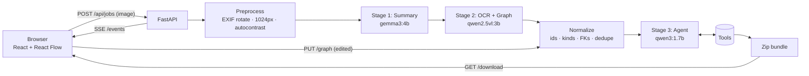

# Diagram2Repo — Architecture

## 1. Overview
Diagram2Repo turns a photo of a whiteboard system diagram or DB schema into a documented, runnable starter repository. Vision models do the perception and produce **validated structured data**. A deterministic normalizer repairs known model mistakes. Then a tool-calling agent turns that data into files using **deterministic Python tools**. No model ever writes a file directly.



## 2. Components

| Component | Path | Responsibility |
|---|---|---|
| API | `backend/app/main.py` | Routes, CORS, background jobs, SSE, serves `frontend/dist` |
| Config | `backend/app/config.py` | `pydantic-settings` from `.env`: Ollama URL, models, caps |
| Schemas | `backend/app/schemas.py` | Data contracts shared by every stage |
| LLM gateway | `backend/app/llm.py` | Only Ollama client (native API). Image preprocessing, `chat_json` (schema `format` + pydantic + repair retry), `<think>`/fence stripping, `unload` |
| Stage 1 | `backend/app/pipeline/summarize.py` | Image → `ArchitectureSummary` |
| Stage 2 | `backend/app/pipeline/extract.py` | Image + summary hint → `Graph` |
| Normalize | `backend/app/pipeline/normalize.py` | Slug ids, resolve edges by id/label, infer kind/tech, fix OCR quirks, infer FKs, add Postgres if tables exist |
| Stage 3 | `backend/app/pipeline/agent.py` | Tool-calling loop + deterministic fallback |
| Orchestrator | `backend/app/pipeline/run.py` | Runs stages, publishes events, `MODEL_LOCK` |
| Tools | `backend/app/tools/*.py` | Pure generators (§5). `catalog.py` holds per-technology knowledge |
| Jobs | `backend/app/jobs.py` | In-memory job store + event log, 1h TTL |
| CLI | `backend/app/pipeline/cli.py` | Run the pipeline from the terminal |
| Frontend | `frontend/src/` | draw.io-style editor (§8) |

## 3. Data contracts
```python
NodeKind = Literal["service", "database", "cache", "queue", "gateway", "frontend", "external", "unknown"]

class Node(BaseModel):
    id: str                    # slug, unique: "orders-api" (also the compose service name)
    label: str                 # as written on the board: "Orders API"
    kind: NodeKind = "unknown"
    ports: list[int] = []
    tech: str | None = None    # "postgres", "redis", "express", "fastapi", ...

class Edge(BaseModel):
    source: str                # Node.id (arrow tail)
    target: str                # Node.id (arrow head)
    label: str | None = None
    protocol: str | None = None

class Column(BaseModel):
    name: str
    type: str = "String"       # normalized: String Int BigInt Float Decimal Boolean DateTime Json Uuid
    pk: bool = False
    fk: str | None = None      # "users.id"
    nullable: bool = True
    unique: bool = False

class Table(BaseModel):
    name: str
    columns: list[Column]

class Graph(BaseModel):
    nodes: list[Node]; edges: list[Edge]; tables: list[Table] = []

class ArchitectureSummary(BaseModel):   # defaults: a partial summary beats a failed stage
    title: str = "Whiteboard Project"
    description: str = ""
    data_flow: str = ""                 # "Browser → Nginx → Orders API → Postgres"
    recommended_stack: dict[str, str] = {}

class GenerateOptions(BaseModel):       # chosen by the user in the UI
    license_type: Literal["MIT", "Apache-2.0", "BSD-3-Clause"] = "MIT"
    author: str = "Your Name"
    project_name: str | None = None
```
Everything after stage 2 depends only on `Graph` + `ArchitectureSummary`. The tools are therefore testable without models, and a user-edited graph can be regenerated without re-running OCR.

## 4. Models

| Role | Env var | Default | Notes |
|---|---|---|---|
| Vision summary | `VISION_MODEL` | `gemma3:4b` | ~115 s on the dev CPU. Swap for a Gemma 4 vision model when available |
| OCR + graph | `OCR_MODEL` | `qwen2.5vl:3b` | ~200 s on the dev CPU. Use `qwen2.5vl:7b` with ≥16 GB RAM / a GPU |
| Agent | `AGENT_MODEL` | `qwen3:1.7b` | Hybrid Qwen3, `think: false` works. One reply can carry several tool calls |

**Why not `qwen3:4b` for the agent:** Ollama's `qwen3:4b` is the *Thinking-2507* build, and its thinking cannot be disabled. On CPU it generated 270–480 tokens per tool call at ~2.5 tok/s, so the agent stage took 935 s. `qwen3:1.7b` with thinking off made all tool calls in one 19 s reply.

**Providers.** `LLM_PROVIDER=ollama` (default) runs everything locally and offline. `LLM_PROVIDER=hosted` sends the same prompts to an OpenAI-compatible provider. The default target is DigitalOcean Serverless Inference (`https://inference.do-ai.run/v1`, model access key), so a public deployment works without a GPU.

Suggested open-weight hosted models: `gemma-4-31B-it` (summary + OCR; fallback `nemotron-3.5-super-vl`) and `openai-gpt-oss-20b` (agent). Hosted calls aren't streamed or unloaded, and jobs aren't serialized (`model_lock` is a no-op when `client.local` is false). If a model rejects `response_format: json_schema`, the client retries without it, and `extract_json` + the repair prompt still validate the output.

**Calling conventions** (`llm.py`):
- Native `/api/chat`. Images are sent as base64 in `messages[].images`.
- Vision stages use `format` = the pydantic JSON schema (with `$defs` inlined), `temperature: 0`, and `num_predict` ≤ 3072.
- The agent uses the model's default sampling (greedy decoding loops Qwen3), `num_predict` 256 and `num_ctx` 4096.
- The 7 GB RAM box can hold only one model, so stages run strictly in sequence and each stage ends by unloading its model (`/api/generate` with `keep_alive: 0`).

## 5. Agent tools
The graph is **injected from `ToolContext`** instead of being passed as arguments. A 1.7–4B model copying a large JSON graph into every call is slow and error-prone. The model decides what to call (and a few options). The tools read the authoritative graph, which the user may also have edited.

| Tool | Model-visible args | Output (into `ctx.files`) |
|---|---|---|
| `validate_port_conflicts` | none | Port per container (declared port, else tech default). Duplicates bump to the next free port, recorded in `remapped` and warnings |
| `generate_docker_compose` | none | `docker-compose.yml` plus `services/<id>/Dockerfile` placeholder servers for custom services (§6) |
| `generate_db_schema` | none | `prisma/schema.prisma` + `db/init.sql` (Postgres). Only when there are tables |
| `generate_readme_and_license` | `license_type`, `project_name`, `author` | `README.md` (summary, Mermaid diagram, services table, quickstart, schema) and `LICENSE` (MIT / Apache-2.0 / BSD-3-Clause) |
| `generate_env_and_makefile` | none | `.env.example` (host ports, credentials, host `DATABASE_URL`) + `Makefile` (`up down logs ps reset db-shell`) |
| `bundle_zip_download` | none | Zip in memory under `<project-root>/`. Refuses until the other required tools ran |

Prerequisites run implicitly (e.g. compose runs the port check if it hasn't run). User choices from the UI override the model's arguments. Model-supplied names that look like placeholders ("your-project-name") are ignored, and the author always comes from the user.

### Agent loop (`pipeline/agent.py`)
1. A compact system prompt gives the project, component list, table names and the required tool order.
2. The loop runs up to `AGENT_MAX_TURNS` (8). Each tool call is validated and executed, and its result goes back as a `tool` message. Unknown tools and bad arguments come back as errors.
3. Loop guards: a tool called more than twice is refused. Two turns without tool calls, a model error or a timeout end the loop.
4. **Deterministic fallback:** any required tool not yet completed is run by the orchestrator (`by: "fallback"`) and a `warning` event is emitted, so every run produces a repo.

## 6. Generated repo
```
online-bookstore/
├─ docker-compose.yml      # services keyed by node id; host ports via ${ID_PORT:-p}
├─ .env.example
├─ Makefile
├─ README.md
├─ LICENSE
├─ prisma/schema.prisma    # named relations, @@map to snake_case tables, @@id for composite keys
├─ db/init.sql             # CREATE TABLE … then ALTER TABLE … FOREIGN KEY (order-independent)
└─ services/<id>/…         # starter app in the chosen stack (see below)
```

### Stack choice (download dialog)
Before the zip is downloaded, the user picks a stack per category (`StackChoice` in `GenerateOptions.stack`). "As drawn" keeps each component's own tech.

| Category | Options | Starter files per component (`tools/starters.py`) |
|---|---|---|
| Backend services | Node.js + Express · Python + FastAPI · Go | `package.json` + `src/index.js` · `requirements.txt` + `main.py` · `go.mod` + `main.go`, each with a `Dockerfile` |
| Frontends | React + Vite · Static HTML | `package.json`, `vite.config.js`, `index.html`, `src/App.jsx` · `index.html` served by nginx (container port 80) |
| Database | PostgreSQL 16 · MySQL 8.4 | Same tables, rendered per dialect (`schema_gen.DIALECTS`): MySQL uses backticks, `AUTO_INCREMENT`, `VARCHAR(191)`, `CHAR(36)` UUIDs, `provider = "mysql"` |

- Every starter serves `/health`, plus `/` reporting which connection env vars compose injected (`DATABASE_URL`, `REDIS_URL`, `<ID>_URL`, …).
- `tools/stack.apply_stack()` rewrites tech on a **copy** of the graph just before generation, so the canvas keeps the graph as drawn.
- `stack.primary_sql_db()` picks the SQL database most components are wired to. It receives `init.sql` and is the one used by the host `DATABASE_URL` and `make db-shell`.

The **Download** menu also exports the canvas as **PNG or JPG**: the whole diagram at 2× resolution on white, captured from `.react-flow__viewport` by `html-to-image` (`frontend/src/lib/exportImage.ts`). The repository download regenerates deterministically (no agent, under 1 s) with the chosen stack, then saves the zip.
Compose rules (`tools/compose.py`, `tools/catalog.py`):
- Known tech maps to a pinned image (`postgres:16-alpine`, `redis:7-alpine`, `rabbitmq:3-management`, `apache/kafka:3.8.0`, `mongo:7`, `mysql:8.4`, `nginx:alpine`, `minio`). Anything else becomes `build: ./services/<id>`.
- Arrows show data flow, not start order. **Infra (database/cache/queue) is always the dependency**, so `Kafka → Worker` makes the worker depend on Kafka. Cycles are skipped with a warning.
- Dependants get connection env vars (`DATABASE_URL`, `REDIS_URL`, `AMQP_URL`, `KAFKA_BROKERS`, `<ID>_URL`). Postgres/Redis get healthchecks and `depends_on: condition: service_healthy`.
- `db/init.sql` is mounted into the first Postgres at `/docker-entrypoint-initdb.d`.

## 7. API

| Method | Path | Purpose |
|---|---|---|
| `GET` | `/api/health` | Ollama reachable + whether each configured model is installed |
| `GET` | `/api/samples` | List `samples/*.json` |
| `POST` | `/api/samples/{name}` | Start a job from a sample graph (tools only, no models) |
| `POST` | `/api/jobs` | Multipart `image` (+ `license_type`, `author`). Starts the full pipeline |
| `GET` | `/api/jobs/{id}` | Status, summary, graph, options, files, warnings, download URL |
| `GET` | `/api/jobs/{id}/events` | SSE: replays history, then streams live. Honours `Last-Event-ID` / `?after=` |
| `PUT` | `/api/jobs/{id}/graph` | `{graph, options, use_agent}`: re-runs normalize + generate only |
| `GET` | `/api/jobs/{id}/image` | Preprocessed photo |
| `GET` | `/api/jobs/{id}/download` | `application/zip` |

**SSE event types:** `status`, `stage_started` {stage, model}, `stage_done` {stage, seconds}, `progress` {stage, tokens}, `summary`, `graph` {graph, raw?}, `tool_call` {name, args, ok, by, files, error}, `agent_message`, `warning`, `error`, `done`.

**Job lifecycle:** `queued → preprocessing → summarizing → extracting → normalizing → generating → done | failed`. A failed summary is downgraded to a warning, but a failed extraction fails the job.

## 8. Frontend (draw.io-style editor)
```
┌ menubar: logo · title · model health · Upload · Samples · Regenerate · Download zip ┐
├ Shapes palette      ┬  canvas (React Flow, dot grid)         ┬ Format panel          ┤
│ Pipeline stages     │  draw.io shapes per kind, ER tables,   │ node / edge / table   │
│  + agent tool log   │  FK links, minimap                     │ editor, or Project:   │
│ Files               │                                        │ summary + license     │
├─────────────────────┴ page tabs: Diagram · Photo · open files ┴───────────────────────┤
```
- `useJob.ts` folds SSE events into UI state. `App.tsx` keeps an editable copy of the graph, and the canvas is controlled from it.
- Fresh graphs are auto-laid-out with dagre: components left-to-right, tables underneath ordered by FK. Regenerations keep manual positions.
- Users drag shapes in, connect handles, edit labels/kinds/ports/columns, delete with Del, then **Regenerate** (with or without the agent).
- **Download ▾** offers *Diagram as PNG*, *Diagram as JPG* and *Repository (.zip)…*. The zip option opens the stack dialog (§6).
- The canvas stays mounted under the Photo and file views, so manual positions survive tab switches and image export works from any tab.
- While the vision stages run, the Photo view shows a scanning animation. `?sample=<name>` loads a sample directly, for demos.

## 9. Failure modes & mitigations

| Failure | Mitigation |
|---|---|
| Misread handwriting | Editable canvas + `PUT /graph` regenerate (no re-OCR) |
| "… API" box tagged `gateway`, protocol in `tech` | Normalizer: gateway kept only with gateway words; protocol words cleared from `tech` |
| Tables repeated as database boxes | Unconnected boxes named like a table are dropped (warning) |
| FK on the wrong column | `<x>_id` → `x(s).id` inference; FK removed from a PK `id` when inferred elsewhere |
| Missing JSON keys / prose / fences | `format` schema, lenient defaults, `extract_json`, one repair prompt |
| Agent thinks forever / loops | Non-thinking model, `num_predict` cap, repeat guard, deterministic fallback |
| Duplicate / missing ports | `validate_port_conflicts` remaps and fills defaults |
| Out of memory | Sequential stages, unload after each, 1024px images, small models |
| Ollama down / model missing | `/api/health` → toolbar chip names the missing model |

## 10. Testing
- `backend/tests/test_tools.py`: ports, compose (YAML parses, unique host ports, `depends_on` direction, env injection, cycles, Kafka listeners), Prisma/SQL (every table, FKs, composite PK, FK types), README/LICENSE, `.env`/Makefile, zip.
- `test_normalize.py`: inference rules + a **real qwen2.5vl output fixture**.
- `test_llm.py`: JSON extraction variants, schema inlining.
- `test_agent.py`: scripted fake model, covering the happy path, user options vs model, early stop, model error, bad tool names and placeholder names.
- `test_api.py`: sample job end-to-end through HTTP, plus graph edit → regenerate.
- Manual: `python -m app.pipeline.cli photo.jpg`, then the UI.

## 11. Future work
- GPU hardware: `qwen2.5vl:7b`, a Gemma 4 vision model, `qwen3:4b` thinking for richer agent decisions.
- Per-service code stubs by framework (Express/FastAPI skeletons wired to `DATABASE_URL`).
- Multi-photo jobs (architecture board + schema board).
- One-click "push to new GitHub repo".
